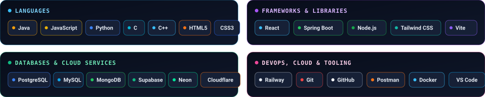
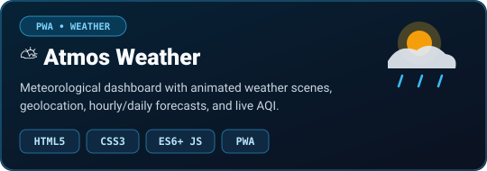
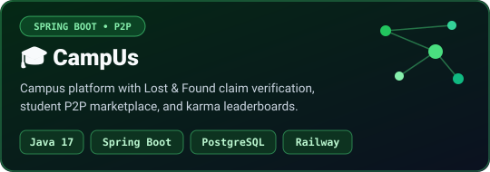
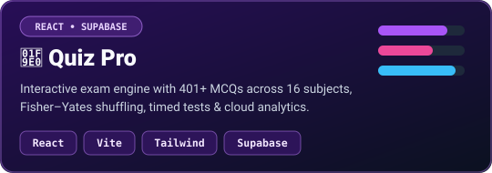
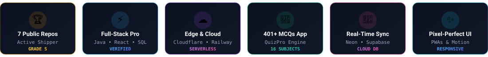

<!-- Animated Cyber Hero Banner -->

  
  
  
  
  
  

<!-- 01 // ABOUT ME -->

<!-- 02 // TECH ARSENAL & ENGINEERING PILLARS -->

<!-- 03 // FEATURED REPOSITORIES & HIGHLIGHTS -->

<table width="100%">
  <tr>
    <td width="50%" align="center" valign="top">
      
      

        
        
      

    </td>
    <td width="50%" align="center" valign="top">
      
      

        
        
      

    </td>
  </tr>
  <tr>
    <td width="50%" align="center" valign="top">
      
      

        
        
      

    </td>
    <td width="50%" align="center" valign="top">
      
      

        
        
      

    </td>
  </tr>
  <tr>
    <td width="50%" align="center" valign="top">
      
      

        
        
      

    </td>
    <td width="50%" align="center" valign="top">
      
      

        
        
      

    </td>
  </tr>
</table>

<!-- 04 // GITHUB TELEMETRY & LIVE STATISTICS -->

<!-- Live Animated Contribution Snake -->
<picture>
  <source media="(prefers-color-scheme: dark)" srcset="https://raw.githubusercontent.com/jayprakashkkk/jayprakashkkk/output/github-contribution-grid-snake-dark.svg" />
  <source media="(prefers-color-scheme: light)" srcset="https://raw.githubusercontent.com/jayprakashkkk/jayprakashkkk/output/github-contribution-grid-snake.svg" />
  
</picture>

  
  

