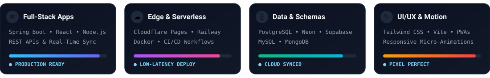
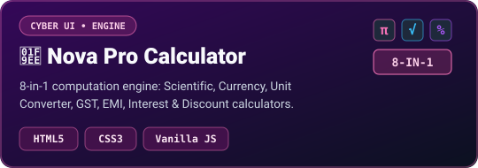
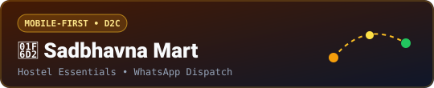

<!-- Animated Cyber Hero Banner -->

  
  
  
  
  
  

<!-- 01 // ABOUT ME -->

- 🔭 **Building**: Modern, responsive full-stack applications with edge delivery and real-time cloud sync.
- 🌱 **Core Focus**: Java (Spring Boot), JavaScript (React, Node.js), PostgreSQL, and modern Cloudflare/Railway serverless architectures.
- 👯 **Open to Collaboration**: Innovative web applications, campus utilities, and open-source developer tools.
- 💬 **Ask Me About**: Frontend architecture, responsive UI/UX, REST APIs, database schemas, and performance optimization.
- ⚡ **Fun Fact**: *I can spend hours happily debugging a single semicolon or CSS transform to make it pixel-perfect.*

<!-- 02 // TECH ARSENAL & ENGINEERING PILLARS -->

#### 💻 Languages

  
  
  
  
  
  
  

#### ⚛️ Frameworks & Libraries

  
  
  
  
  

#### 🗄️ Databases & Cloud Services

  
  
  
  
  
  
  

#### 🔧 Developer Tools & Platforms

  
  
  
  
  

<!-- 03 // FEATURED REPOSITORIES & HIGHLIGHTS -->

<!-- TODO: Replace the Live Demo placeholder URLs below with your deployed project links -->
<table width="100%">
  <tr>
    <td width="50%" valign="top">
      
      
<strong>Stack:</strong> <code>HTML5</code> <code>CSS3</code> <code>ES6+ JS</code> <code>PWA</code>

      
Meteorological dashboard with animated weather conditions, geolocation, hourly &amp; daily forecasts, and air quality indices.

      

        <!-- TODO: Replace with Atmos Weather live demo URL -->
        
        
      

    </td>
    <td width="50%" valign="top">
      
      
<strong>Stack:</strong> <code>Java 17</code> <code>Spring Boot</code> <code>PostgreSQL</code> <code>Railway</code>

      
Comprehensive campus platform with Lost &amp; Found claim verification, student peer-to-peer marketplace, and karma leaderboards.

      

        <!-- TODO: Replace with CampUs live demo URL -->
        
        
      

    </td>
  </tr>
  <tr>
    <td width="50%" valign="top">
      
      
<strong>Stack:</strong> <code>React</code> <code>Vite</code> <code>Tailwind</code> <code>Supabase</code>

      
Interactive examination engine featuring 401+ MCQs across 16 subjects, Fisher–Yates shuffling, timed tests, and cloud score analytics.

      

        <!-- TODO: Replace with Quiz Pro live demo URL -->
        
        
      

    </td>
    <td width="50%" valign="top">
      
      
<strong>Stack:</strong> <code>JavaScript</code> <code>Cloudflare Pages</code> <code>Neon DB</code>

      
Minimalist task planner with smart recipe assistant and real-time cross-device cloud sync powered by Neon Serverless PostgreSQL.

      

        <!-- TODO: Replace with Taskly live demo URL -->
        
        
      

    </td>
  </tr>
  <tr>
    <td width="50%" valign="top">
      
      
<strong>Stack:</strong> <code>HTML5</code> <code>CSS3</code> <code>Vanilla JS</code>

      
8-in-1 computation engine combining Scientific, Currency, Unit Converter, GST, EMI, Interest, and Discount calculators in a sleek dark cyber UI.

      

        <!-- TODO: Replace with Nova Pro Calculator live demo URL -->
        
        
      

    </td>
    <td width="50%" valign="top">
      
      
<strong>Stack:</strong> <code>HTML5</code> <code>CSS3</code> <code>FontAwesome</code>

      
Mobile-first hostel late-night essentials ordering platform with direct WhatsApp dispatch and door-to-door room delivery routing.

      

        <!-- TODO: Replace with Sadbhavna Mart live demo URL -->
        
        
      

    </td>
  </tr>
</table>

<!-- 04 // GITHUB TELEMETRY & LIVE STATISTICS -->

  
  

<!--
  🐍 CONTRIBUTION SNAKE ANIMATION:
  Once you push and run the "Generate Contribution Snake" GitHub Action
  (Actions tab -> Generate Contribution Snake -> Run workflow),
  uncomment the block below to display the animated snake on your profile!

  <picture>
    <source media="(prefers-color-scheme: dark)" srcset="https://raw.githubusercontent.com/jayprakashkkk/jayprakashkkk/output/github-contribution-grid-snake-dark.svg" />
    <source media="(prefers-color-scheme: light)" srcset="https://raw.githubusercontent.com/jayprakashkkk/jayprakashkkk/output/github-contribution-grid-snake.svg" />
    
  </picture>
-->

